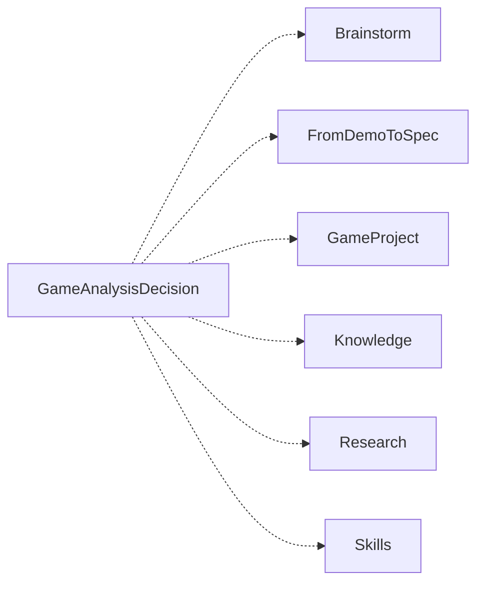

# GameAnalysisDecision


[English](README.en.md)

## 独立使用与相关模块

本仓是 GameAnalysisDecision 的独立发布内容。按下方业务入口开始，实际环境要求见模块文档与 [module.json](module.json)。AWS 与 meta 可以按需要提供跨模块协作和宿主治理，当前用户授权与已有宿主规则保持权威。

模块相关能力、数据交接和安装审阅见 [协作说明](docs/module-cooperation.md)。只读取本次任务需要的入口，用户项目、账号、资料和工具运行环境按各业务文档放在包外。

```text
python .module/module_manager.py verify
python .module/module_manager.py related
python .module/module_manager.py audit --target <workspace> --modules <related-id>
python .module/module_manager.py fetch --target <workspace> --modules <related-id> --apply
```

先审阅已有同类模块、输入输出和数据归属，再按实际需要执行获取。已有同版本模块通过身份与库存核对后复用，具体业务接线沿协作说明决定。

<!-- module-panorama:start -->


虚线表示可选协作。具体用途与接口见 module.json 和协作说明。 / Dashed edges indicate optional cooperation. See module.json and the cooperation guide.
<!-- module-panorama:end -->

直接提出游戏设计、系统、体验或交付问题。Agent 从 [分析协议](protocols/analysis.md) 开始，核对项目事实、选择相关方法、实际查证，再给出条件建议。没有其他包也能分析，不要求填写表格或启动专家团队。

- [专业目录](agents/catalogue.json)：完整的现行专家、视角、6 个 Method 与 13 个 Procedure；按需读取，未正常启用的候选不默认装配；default_use条目按题直接选用。
- [问题与操作](agents/BUILD_GUIDE.md)、[统一选用规则](protocols/selection.md)、[交付](protocols/delivery.md)、[学习与撤回](protocols/learning.md)。公开包的学习状态从空白开始，不继承私人验收。
- [Provider](providers/README.md)：Knowledge 可选；缺少材料只收窄相关结论。
- [v2 交接](adapters/v2/README.md)：Brainstorm、FromDemoToSpec 或自定义宿主使用同一权限边界。

在包目录运行（Node.js 22+；学习基线验证另需 Git）：

```text
node scripts/learning-cli.mjs audit
node scripts/learning-cli.mjs resolve examples/query.json
node scripts/learning-cli.mjs lookup examples/query.json
node --test tests/test-provider-v2.mjs tests/test-learning-v2.mjs tests/test-adapter-v2.mjs tests/test-analysis-math.mjs
```

示例是明确存在分析缺口时选择候选；结果是方法正文，不是已完成分析。来源列表不是已读材料，工具通过不是方法收益或真实体验通过。普通结论由宿主消费；正式决定、真实 Play 和新增授权由用户拥有。版权与原来源授权不因公开改变。

## Bounded independent investigations

`node scripts/subagent-task.mjs --request <task.json>` prepares one bounded task from the existing professional selection. The optional Codex role is bundled with the module. See [host support and fallback](protocols/subagents.md). Actual invocation requires host discovery, supported execution tools and current authorization.
